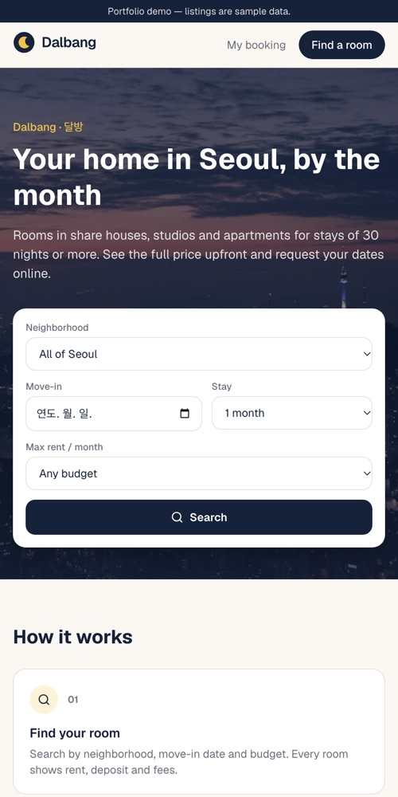
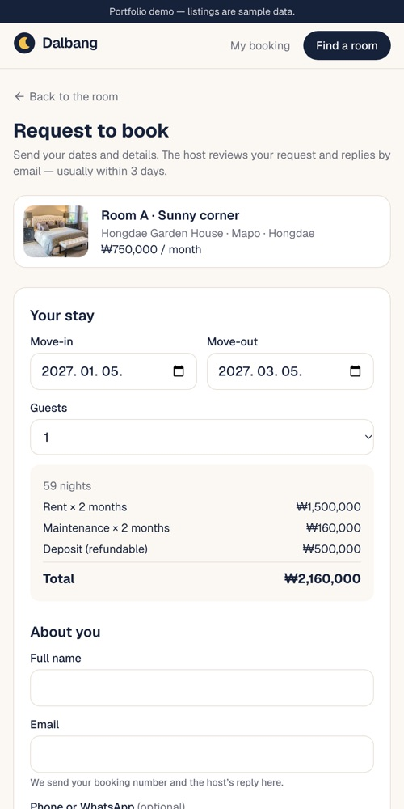
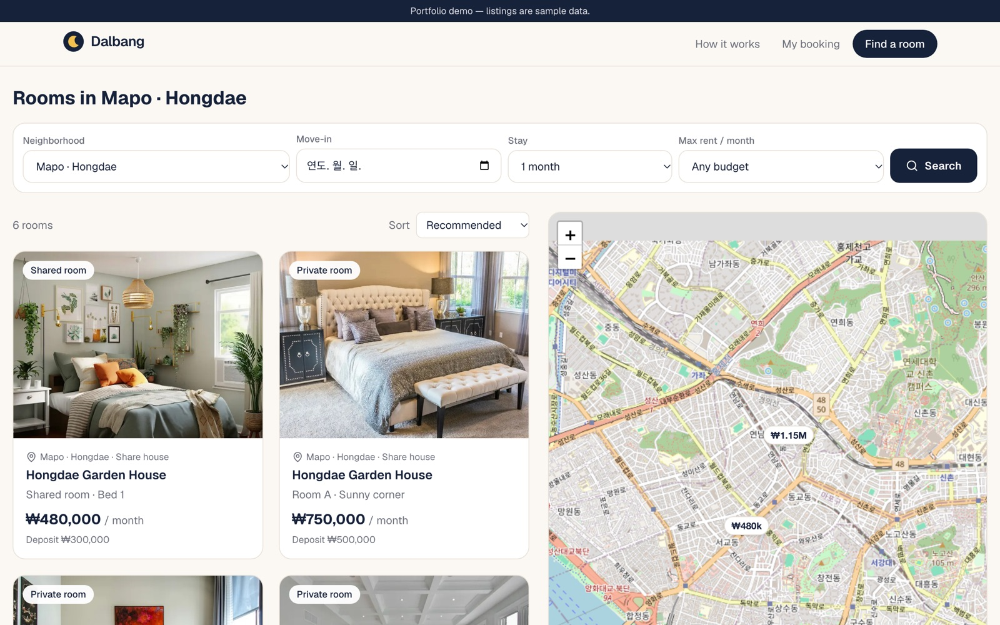

# Dalbang (달방)

> **Monthly rooms in Seoul** — 서울에 한 달 이상 머무는 외국인을 위한 방 단위 숙소 예약 요청 서비스
>
> 🔗 https://dalbang.vercel.app · 포트폴리오 데모 (숙소·사진·가격은 예시 자료)

<p>
  
  
</p>



## 무엇을 하는 서비스인가

1. 손님은 **동네·입주일·기간·예산**으로 방을 찾습니다. 그 날짜에 확정 예약이 있는 방은 검색에서 빠집니다.
2. 날짜를 고르면 **월세·남는 날·관리비·보증금을 합친 총액**이 바로 나옵니다.
3. 회원가입 없이 **예약 요청**을 보내고, 예약 번호와 이메일로 진행 상태를 조회합니다.
4. 관리자는 요청을 **승인·거절**하고, 결과는 **이메일**로 손님에게 갑니다. 결제는 없지만, 나중에 붙일 수 있게 상태값과 가격 기록(스냅샷)을 준비해 두었습니다.

## 설계에서 신경 쓴 점

| 문제 | 해결 |
|---|---|
| 두 관리자가 같은 날짜를 동시에 승인하면? | PostgreSQL **겹침 제외 제약(exclusion constraint)**으로 DB가 직접 막음. 5명 동시 승인 시험에서 1건만 성공 |
| 승인과 "겹치는 다른 요청 자동 거절"이 반쪽만 되면? | DB 함수 하나(`decide_booking`)로 **트랜잭션** 처리 + 처리 기록 |
| 손님이 화면에서 금액을 조작하면? | 총액 계산은 한 함수(`src/lib/pricing.ts`)에만 두고, **서버가 저장 직전에 다시 계산** |
| 다른 사람의 예약을 엿보면? | 예약 표는 RLS로 방문자 접근 차단. 조회는 **예약 번호 + 이메일**이 둘 다 맞아야 함. 횟수 제한 |
| 관리자 화면 보호 | 프록시(1차) → 화면·기능마다 서버가 관리자 명단 확인 → DB 보안 규칙(RLS) 3중 |
| 개인정보 | 필요한 것만 수집, 동의 기록, 보관 기간이 지나면 **자동 익명화**. 로그에 개인정보를 남기지 않음 |
| 메일 실패 | 예약 처리는 그대로 완료, 실패는 기록 → 관리자 화면에서 "다시 보내기" |
| 비용 | **0원**: Vercel·Supabase 무료 요금제, 도메인 미구매, Gmail SMTP |

## 기술

- **Next.js 16** (App Router, Server Actions, Proxy) · TypeScript · Tailwind CSS
- **Supabase** (PostgreSQL, Auth, Storage, RLS) — 표 구조는 전부 `supabase/migrations/`
- next-intl (화면 글자는 `messages/en.json`) · zod (입력 검사) · Leaflet + OpenStreetMap · Nodemailer
- Vercel (서울 리전 `icn1`, Cron) · GitHub Actions (Supabase 일시정지 방지)

## 품질

| 항목 | 결과 |
|---|---|
| 단위 시험 `npm test` | 47개 — 총액 계산(윤년·월말 예외 포함), 예약 규칙, 메일 내용 |
| DB 시험 `npm run test:db` | 12개 — 겹침 금지·동시 승인·자동 거절·만료·개인정보 삭제·횟수 제한·전체 흐름 |
| 사이트 점검 `npm run test:smoke` | 14개 — 주요 화면, 404, 관리자 차단, 보안 헤더 |
| Lighthouse (모바일) | 성능 90~98 · 접근성 100 · 권장사항 100 · SEO 100 |

## 폴더 구조

```
src/app/            화면 (손님: /, /rooms, /rooms/[id], /booking/…, 관리자: /admin/…)
src/lib/pricing.ts  총액 계산 (유일한 계산 함수)
src/lib/booking-rules.ts  예약 요청 검사 규칙
src/lib/repo*.ts    DB 읽기·쓰기 창구 (화면은 여기만 거쳐 DB에 접근)
src/lib/mail/       메일 (보내는 코드는 transport.ts 한 곳)
supabase/migrations 표·보안 규칙·DB 함수
tests/              DB 시험·사이트 점검
docs/               기획(PLAN), 진행(PROGRESS), 공부 노트(LEARNING), 체험 안내(DEMO)
```

## 내 컴퓨터에서 실행

```bash
npm install
cp .env.example .env.local   # 값 채우기 (Supabase 주소·키 등)
npm run db:push              # 표·보안 규칙 만들기 (마이그레이션 적용)
node scripts/supabase-db.mjs db push --include-seed   # 예시 자료 넣기
npm run dev                  # http://localhost:3000
```

체험 순서는 [docs/DEMO.md](docs/DEMO.md)를 보세요.
